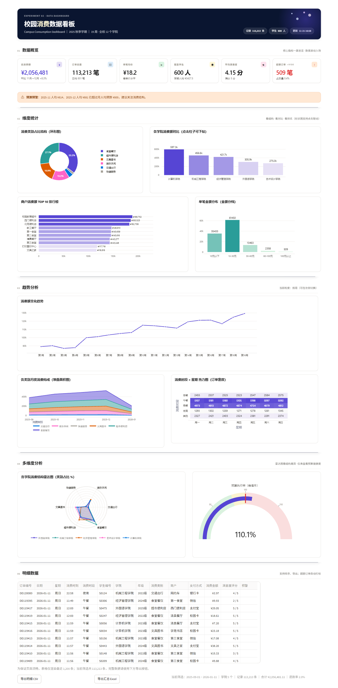
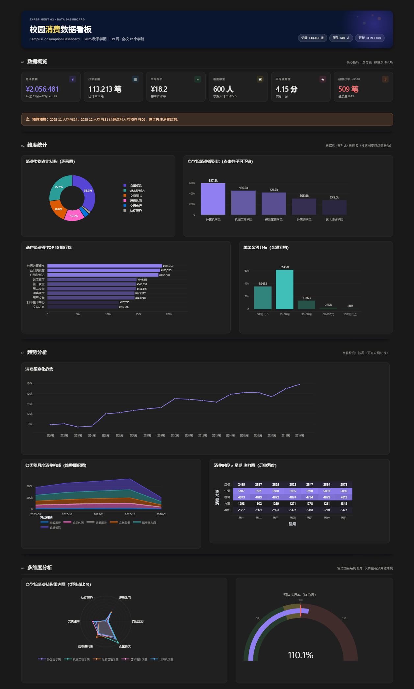

# 实验2 数据看板的设计与实现 —— 校园消费数据看板

> 课程：Python 程序设计　｜　实验学时：2~4 学时　｜　技术栈：Streamlit + Pandas + Plotly
>
> 仓库：<https://github.com/ArenBase/Consumption-Dashboard>
>
> 视觉规范：[`DESIGN.md`](DESIGN.md)（设计令牌取自开源项目
> [VoltAgent/awesome-design-md](https://github.com/VoltAgent/awesome-design-md) 的 `design-md/notion/DESIGN.md`）

一个基于 **Streamlit + Pandas + Plotly** 的校园消费数据看板，覆盖实验要求的
「数据概览区 / 维度统计区 / 趋势分析区 / 明细数据区」四大模块，并实现了进阶与扩展任务
中的筛选联动、图表下钻、热力图、雷达图、仪表盘、实时刷新、阈值预警、数据导出、亮暗主题等功能。

界面按 Notion 的设计语言重做：暖白底 + 发丝边框卡片 + Notion 紫主色 + 深 navy 页头横幅，
亮色 / 暗色两套令牌一一对应。



---

## 一、目录结构

```
Consumption-Dashboard/
├── app.py                              # 看板主程序（含全局 CSS 与图表规范）
├── generate_data.py                    # 模拟数据生成 + 数据预处理脚本
├── DESIGN.md                           # 视觉规范（令牌 / 组件 / 图表规则）
├── requirements.txt                    # 依赖清单
├── 启动看板.bat                        # Windows 一键启动脚本（GBK + CRLF）
├── README.md                           # 本文件
├── .gitignore
├── .streamlit/
│   └── config.toml                     # Streamlit 主题与服务端配置
├── data/
│   ├── 校园消费原始数据_前2000条样例.xlsx  # 原始数据样例（便于查看字段，144 KB）
│   ├── 校园消费原始数据.csv             # 本地生成，不入库（14 MB / 121,320 条）
│   └── 校园消费数据.csv                 # 本地生成，不入库（19 MB / 115,508 条）
└── 截图/                               # 成品截图（亮色 / 暗色 / 实时流 / 侧边栏）
```

---

## 二、快速开始

### 方式一：一键启动（推荐）

双击 `启动看板.bat`。脚本会依次完成：

1. 切换到脚本所在目录（避免双击时工作目录是 `C:\Windows\System32`）；
2. 优先使用工作区根目录的 `.venv`，其次 `python`，最后 `py -3`；
3. 用 `python -c "import streamlit, pandas, plotly, numpy, openpyxl"` 检查依赖，缺失才安装；
4. 数据文件缺失时自动执行 `generate_data.py`；
5. `streamlit run app.py --server.headless=false`，由 Streamlit 自己打开浏览器。

### 方式二：命令行

```bash
# 1) 安装依赖（首次运行）
pip install -r requirements.txt

# 2) 生成 / 重新生成数据（可选，data/ 目录已附带成品数据）
python generate_data.py

# 3) 启动看板
python -m streamlit run app.py
```

启动后浏览器会自动打开 <http://localhost:8501>。

> **仓库里没有那两个 30 MB 级的 CSV**（已写进 `.gitignore`）：
> 首次双击 `启动看板.bat` 时脚本会自动执行 `generate_data.py` 生成，
> 也可以自己先跑一遍 `python generate_data.py`。仓库只保留了 144 KB 的原始数据样例，
> 方便直接看字段结构。

> 本项目调试用的独立虚拟环境位于工作区根目录 `python/.venv`（不在本工程目录内），
> `启动看板.bat` 会自动优先使用它；换一台机器时按上面的 `pip install` 安装即可。

---

## 三、视觉规范（Notion DESIGN.md）

完整令牌与组件规格见 [`DESIGN.md`](DESIGN.md)，这里只列核心决策：

| 维度 | 取值 | 理由 |
|---|---|---|
| 页面底色 | `#ffffff` / 表面 `#f6f5f4` | 暖白比冷灰更耐看，表格与图表同屏不刺眼 |
| 主色 | `#5645d4`（Notion 紫） | 只给总消费额、主按钮、焦点，不滥用 |
| 卡片 | 1px `#e5e3df` 发丝边框 + 12px 圆角 | 用线条分层，而不是靠阴影堆叠 |
| 页头 | `#0a1530` 深 navy 横幅 + 4 个便签圆点 | 复刻 Notion 官网的 hero band |
| 字体 | Inter → 系统 UI → 苹方 / 雅黑 | Notion Sans 非公开字体，规范给的首选替代就是 Inter |
| 图表 | 透明底、无轴标题、只留横向网格 | 语义交给卡片标题，减少视觉噪音 |
| 暗色 | 同一语义推导（规范未覆盖） | `#191919` 画布 / `#202020` 表面 / 紫提亮为 `#8f7ff0` |

改配色只需要动三处并保持一致：`DESIGN.md` 的令牌表 → `app.py` 的 `THEMES` → `.streamlit/config.toml`。

---

## 四、业务场景与数据说明

**场景：校园一卡通消费分析**（2025 秋季学期，19 周，12 个学院，600 名学生）

数据不是简单随机数，而是按真实业务规律模拟生成：

- **时间维度**：日期、月份、周序、星期、消费时段（早餐 / 午餐 / 晚餐 / 夜宵 / 其他）
- **分类维度**：学院、年级、消费类别、商户、支付方式
- **数值维度**：消费金额、满意度评分

| 规律 | 做法 |
|---|---|
| 月度消费景气 | 9 月开学回落 → 12 月期末季上升（月度系数 0.85 → 1.22） |
| 周末效应 | 周末食堂消费下降、娱乐与超市消费上升 |
| 客单价差异 | 各品类用不同的对数正态分布（食堂约 14 元、娱乐约 35 元） |
| 时段关联 | 食堂集中在早 / 午 / 晚三餐，娱乐集中在晚餐与夜宵 |
| 学院偏好 | 各学院对品类有不同偏好（如艺术设计学院文具图书占比高），使雷达图有分析价值 |

### 预处理规则

`generate_data.py` 会先故意注入 7 类典型脏数据，再执行清洗：

| 脏数据类型 | 注入条数 | 处理方式 |
|---|---|---|
| 金额缺失 | 1,800 | 剔除（关键字段无法修复） |
| 消费类别缺失 | 1,080 | 剔除 |
| 金额为负 | 840 | 剔除（业务上不允许负消费） |
| 金额极端异常（>5000 元） | 480 | 剔除 |
| 重复订单（网络重传） | 1,320 | 按订单编号去重 |
| 日期越界（时区错误） | 360 | 剔除学期外记录 |
| 满意度评分缺失 | 720 | 用中位数填充（可修复项） |

**清洗结果：121,320 条 → 115,508 条（清洗率 4.8%）**

---

## 五、功能清单（对照实验要求）

### 基础任务（必做）

| 要求 | 实现位置 |
|---|---|
| 任务1 需求分析与版面设计 | 单页四模块布局 + 亮/暗双配色方案（`THEMES`、`DESIGN.md`） |
| 任务2 数据准备与预处理 | `generate_data.py`，输出 CSV + Excel |
| 任务3 基础图表 | 数据卡片 6 个、环形图、柱状图、折线图、条形排行榜、明细表 |
| 任务4 静态看板整合 | 统一卡片、发丝边框、间距、字体、配色，自适应栅格 |
| 任务5 结果验证与总结 | `截图/` 目录 + `博客文档.md` |

### 进阶任务（选做）

- **进阶1 动态视觉优化**：数值滚动动画（count-up）、组件渐入动画、卡片逐张延迟入场、
  hover 悬浮提示、宽屏自适应栅格布局
- **进阶2 图表联动与筛选**：时间区间 + 趋势粒度 + 学院/年级/类别/支付方式多维筛选，
  筛选后全页图表同步更新；**点击学院柱状图可下钻**，联动趋势图与明细表
- **进阶3 多维度分析**：商户 TOP10 排行榜、消费时段×星期热力图、学院消费结构雷达图、
  预算执行率仪表盘

### 扩展任务（加分项）

- **扩展1 实时数据看板**：`st.fragment(run_every=...)` 实现秒级自动刷新，
  动态生成实时流水并自动轮播关注维度
- **扩展2 数据预警**：单笔金额阈值预警（概览卡片转红 + 明细表打标）、
  月人均消费预算预警（超预算弹出桃色 callout）
- **扩展4 数据导出**：明细 CSV 导出 + 多 sheet Excel 汇总导出（构建结果做了缓存）
- **扩展5 个性化定制**：亮色 / 暗色双主题（改 `config.toml` 即可切换）、趋势粒度切换

---

## 六、主题切换（亮色 / 暗色）

看板配色跟随 Streamlit 主题，修改 `.streamlit/config.toml` 中的 `[theme]`：

```toml
[theme]
base = "light"                        # 改成 "dark" 即为暗色
primaryColor = "#5645d4"              # dark: #8f7ff0
backgroundColor = "#ffffff"           # dark: #191919
secondaryBackgroundColor = "#f6f5f4"  # dark: #202020
textColor = "#37352f"                 # dark: #d4d4d1
```

`app.py` 的 `detect_theme()` 会读取实际生效的主题配置，自动切换图表模板、卡片配色与
callout 底色，因此两种主题下图表、卡片、文字、提示条都是配套的。



---

## 七、实现要点

- **缓存**：`@st.cache_data` 缓存 11 万行数据；缓存键包含文件修改时间，
  重新生成数据后看板会自动刷新，不会继续展示旧数据。
- **Excel 导出**：多 sheet 汇总的字节流用 `@st.cache_data` 缓存，避免每次 rerun 重写大表。
- **动画**：KPI 卡片用 `st.iframe` 内嵌 HTML+CSS+JS 实现数值滚动（easeOutCubic）与渐入动画；
  卡片为自绘样式，因此可以做到「超标自动转红」。
- **联动**：柱状图通过 `st.plotly_chart(on_select="rerun")` 捕获点击事件，
  把选中的学院写入 `st.session_state`，再作用于趋势图与明细表。
- **性能**：明细表只渲染最近 1,200 行（完整数据可导出），避免 11 万行一次性传到前端。
- **截图模式**：`?shot=full` 隐藏侧边栏与页脚，`?mod=1..6` 只渲染指定模块，
  `?zoom=0.8` 缩放画布，三者组合即可一屏出一张干净的配图。

---

## 八、常见问题

**Q1：双击 `启动看板.bat` 报一堆乱码，比如 `'笌瀹炵幇' 不是内部或外部命令`**

这是批处理文件的编码 / 换行问题，不是 Python 问题：

1. 文件是 **UTF-8**，而中文 Windows 的 `cmd` 默认按 **GBK(936)** 解析，
   只有 `chcp 65001` 生效之后的行才会按 UTF-8 读，于是前半段中文被打乱成
   `'笌瀹炵幇'` 这类乱码，`echo`、`set` 甚至会被拆成非法命令；
2. 文件是 **LF 换行**，`cmd` 对 LF-only 的批处理解析不稳定，
   `@echo off` 被吃掉一半就出现了 `'cho.'` 这类报错；
3. 乱码行导致 `goto` 跳到了错误位置，于是脚本又去执行 `pip install -r requirements.txt`，
   才出现你截图里的 `Defaulting to user installation ...`。

修复后的 `启动看板.bat`：**GBK 编码 + CRLF 换行 + 无 BOM**，并在第一行 `chcp 936`，
用 `goto` 改成出错即停的结构。若你想自己另存，请务必选「ANSI / GBK」而不是「UTF-8」。

**Q1-b：启动到 `Email:` 这一步，回车后窗口直接消失**

这是第二个独立的坑，和编码无关：

```
[3/3] 正在启动看板： http://localhost:8501
      Welcome to Streamlit!
      Email:        ← 回车后进程退出
```

Streamlit 在**首次运行**且 `server.headless=false` 时，会向终端要邮箱；留空回车后它会
`os.makedirs(~/.streamlit)` 写 `credentials.toml`，这一步在权限受限的机器上会失败：

```
[WinError 5] 拒绝访问。: 'C:\Users\lenovo\.streamlit'
```

`check_credentials()` 捕获异常后直接 `sys.exit()`，于是看板还没启动就退出了。

现在的 `启动看板.bat` 加了 `--server.showEmailPrompt=false`：直接跳过邮箱引导，
不读也不写 `~/.streamlit`。同时脚本末尾改成**无论成功失败都 `pause`**，
并打印退出码与常见原因，窗口不会再一闪而过。

**Q2：`ModuleNotFoundError: No module named 'streamlit'`**

当前 Python 环境没装依赖。双击 `启动看板.bat` 会自动检测并安装；
或手动执行 `pip install -r requirements.txt`，并确认 IDE 选中的解释器与命令行一致。

**Q3：中文显示成乱码**

数据文件均为 `utf-8-sig` 编码；若用 Excel 打开 CSV 出现乱码，请用「数据 → 从文本/CSV」
导入并选择 UTF-8。程序内部统一按 `encoding="utf-8-sig"` 读取。

**Q4：页面提示「未找到数据文件」**

`data/` 目录被删了。双击 `启动看板.bat` 会自动补数据，或执行 `python generate_data.py`。

**Q5：改了数据但看板没变**

点右上角菜单里的 Rerun；本项目的缓存键已绑定文件修改时间，正常情况下会自动刷新。

**Q6：端口 8501 被占用**

改 `启动看板.bat` 里的 `--server.port 8501` 为其他端口（如 8502），
或先关掉占用端口的进程。
